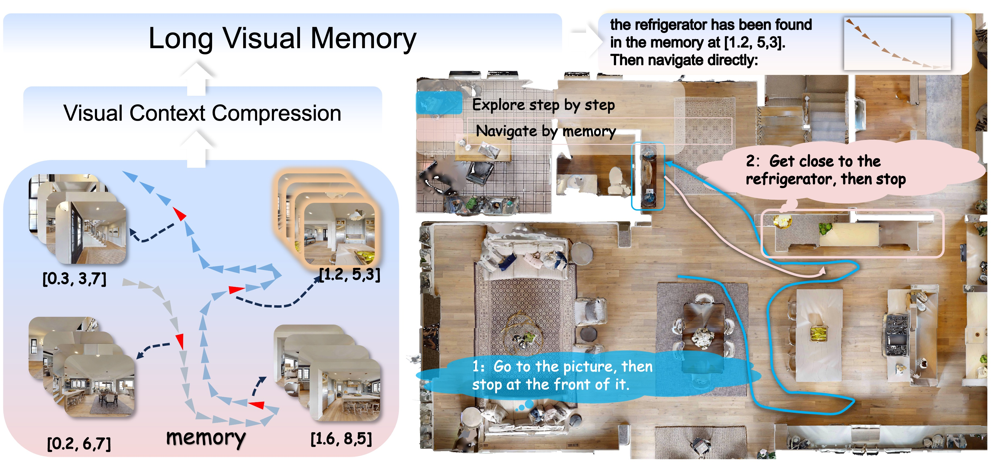
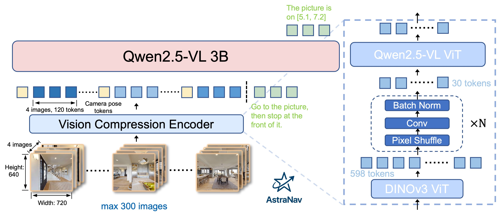

# AstraNav-Memory: Contexts Compression for Long Memory

[](https://astra-amap.github.io/AstraNav-Memory.github.io/)
[](https://www.arxiv.org/abs/2512.21627)

## 🌐 Astra Ecosystem
AstraNav-Memory is part of the **Astra** series for robust embodied intelligence:
*   **AstraNav-Memory (This Repo):** Focuses on long-term implicit memory through visual context compression.
*   **[AstraNav-World](https://github.com/amap-cvlab/AstraNav-World):** Focuses on predictive planning via tightly coupled visual foresight and action generation.
*   **[OmniNav](https://github.com/amap-cvlab/OmniNav):** Focuses on unified multi-paradigm navigation and real-time execution via a fast-slow system.


## Core Highlights
🤏 20× Visual Context Compression: Employs a lightweight PixelUnshuffle+Conv tokenizer to compress frames into ~30 tokens, expanding context capacity from tens to hundreds of images for massive, long-term implicit memory.

🎞️ Qwen-DINO Unified Policy: Couples Qwen2.5-VL reasoning with frozen DINOv3 features in an end-to-end framework, replacing fragile object-centric pipelines with a robust, scalable image-centric memory interface.

🗺️ Lifelong Navigational Mastery: Sets new SOTA benchmarks on GOAT-Bench and HM3D-OVON by balancing efficient exploration in novel environments with optimal, high-speed pathfinding in familiar ones.


### Image-Centric Memory

<div align="center">
    
</div>


### Compression Method

<div align="center">
    
</div>

## 🔥 Latest News!!
* January 20, 2026: We release the inference checkpoints with various downsampling rates and context lengths.
* December 30, 2025: We release the training and inference code.


## Quickstart
### 🧰 Installation

Clone the repo:

```
git clone https://github.com/amap-cvlab/AstraNav-Memory.git
```

Install Training dependencies:
```
# Ensure torch >= 2.6.0
cd train_code
pip install -r requirements.txt
```

Install habitat-sim and habitat-lab for inference
```
● habitat-sim
git clone https://github.com/facebookresearch/habitat-sim.git && cd habitat-sim && git checkout v0.2.3
pip install -r requirements.txt
python setup.py install --headless
● habitat-lab
git clone https://github.com/chongchong2025/habitat-lab && cd habitat-lab && git checkout v0.2.3_waypoint
python -m pip install -r habitat-baselines/habitat_baselines/rl/requirements.txt
python -m pip install -r habitat-baselines/habitat_baselines/rl/ddppo/requirements.txt
pip install -e .
cd habitat-baselines
pip install -e .
```

### 🎁 Model
| Models          |                       Download Link                                           |
|-----------------|-------------------------------------------------------------------------------|
| DS16-Context50  | [ModelScope](https://www.modelscope.ai/models/chongchongjj/AstraNav_Memory_ds16_context50)
| DS16-Context100 | [ModelScope](https://www.modelscope.ai/models/chongchongjj/AstraNav_Memory_ds16_context100)
| DS4-Context100  | [ModelScope](https://www.modelscope.ai/models/chongchongjj/AstraNav_Memory_ds4_context100)
| DS64-Context100 | [ModelScope](https://www.modelscope.ai/models/chongchongjj/AstraNav_Memory_ds64_context100)


### ⚡ Inference
● Goat-Bench
``` python
cd inference_code/hm3d-online
python goat-nav.py
```

● OVON
``` python
cd inference_code/hm3d-online
python ovon-nav.py
```

### ⚡ Training
``` sh
cd train_code
bash run_train.sh
```

## 🏛️ Citation
If you find this repository useful, please consider giving a star ⭐ and citation
```
@article{ren2025astranav-memory,
    title={AstraNav-Memory: Contexts Compression for Long Memory}, 
    author={Botao Ren and Junjun Hu and Xinda Xue and Minghua Luo and Jintao Chen and Haochen Bai and Liangliang You and Mu Xu},
    year={2025},
    eprint={2512.21627},
}
```

## Acknowledgments
Thanks to [OmniNav](https://github.com/amap-cvlab/OmniNav), [MTU3D](https://github.com/MTU3D/MTU3D), and [OVON](https://github.com/naokiyokoyama/ovon) for open-sourcing the construction of training data and the closed-loop inference code. Their contributions have significantly enriched the open-source community.
